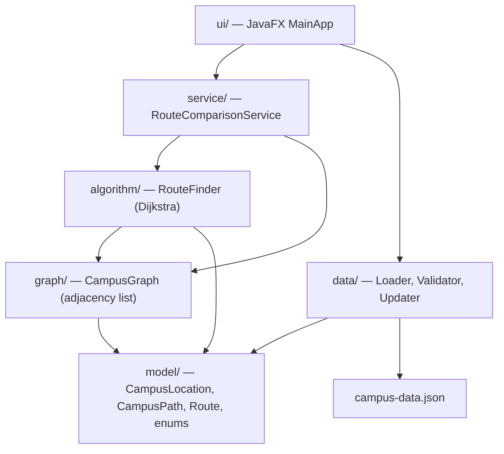
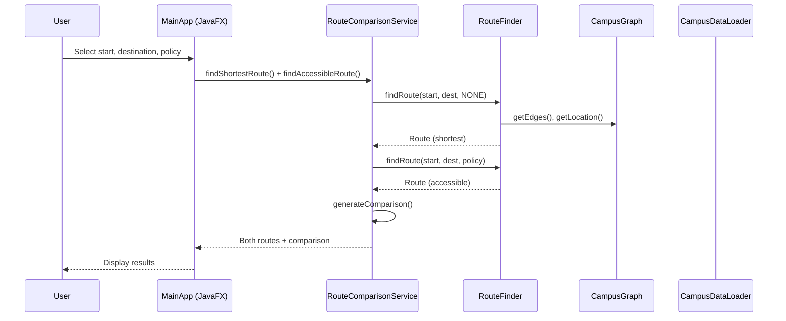

# Accessible Route Adviser — RVCE Campus Navigation

A Java application that models the **RV College of Engineering (RVCE)** campus in Bengaluru as a graph of buildings and gates, and finds **shortest-distance** and **accessibility-prioritized** routes between them.

> **SkillLab Project** · Java 21 · Maven · JavaFX · Jackson · JUnit 5

---

## 1. Problem Statement

Navigating a large campus can be challenging, especially for people who need step-free paths. This application:

- Models the RVCE campus as an **undirected weighted graph** (buildings/gates as nodes, paths as edges).
- Finds the **shortest-distance route** between two locations.
- Finds an **accessibility-prioritized route** that avoids non-step-free paths.
- **Compares** both routes side-by-side with detailed explanations.
- Lets users **update** path data (distances, step-free status, closures) and see results change immediately.

## 2. Objectives and Expected Outcomes

- Demonstrate Java OOP (classes, enums, encapsulation).
- Implement Dijkstra's algorithm with edge-eligibility filtering.
- Show JSON persistence, validation, and safe-save practices.
- Build a working JavaFX UI for interactive route comparison.
- Maintain strict provenance tracking (student data vs. demo data, verified vs. unverified).

## 3. Intended Users and Accessibility Use Cases

- **Students and visitors** navigating the RVCE campus.
- **Users with mobility needs** who require step-free routes.
- **Campus administrators** who might update path data after accessibility surveys.

Use cases:
- "Find the shortest path from Main Gate to CSE Department."
- "Find a route from Admin Block to Library that avoids known non-step-free paths."
- "Report that a path has steps (update stepFree to NO) and see how routes change."

## 4. Technology Stack and Justification

| Technology | Version | Purpose |
|---|---|---|
| Java | 21 (Temurin) | Core language, modern features (records, switch expressions, text blocks) |
| Maven | 3.10.0 | Build, dependency management (wrapper included) |
| JavaFX | 21.0.2 | Desktop GUI (5 tabs: Route Finder, Building Info, Paths, Schematic Map, About) |
| Jackson | 2.17.0 | JSON serialization/deserialization |
| JUnit 5 | 5.10.2 | Unit testing |

**Why JavaFX?** A display is available on this Windows 11 system. JavaFX provides a cross-platform GUI with built-in controls (ComboBox, TableView, Canvas) suitable for this application.

---

## 4.1 Quick Start: Running on Any System

If you send or share this project folder with others, **anyone can run it on Windows, macOS, or Linux** without needing Maven pre-installed.

### Prerequisites
1. **JDK 21 or later** installed (e.g., [Eclipse Adoptium Temurin 21](https://adoptium.net/temurin/releases/?version=21)).
   - Verify by typing in terminal: `java -version`
2. **Internet connection on first run** (so the bundled wrapper can download JavaFX and Jackson dependencies).

### How to Run

#### Windows
- **Option 1 (One-Click):** Double-click [run_gui.bat](file:///run_gui.bat).
- **Option 2 (Terminal):** Open PowerShell or CMD in the project folder and run:
  ```cmd
  mvnw.cmd javafx:run
  ```

#### macOS / Linux
- **Option 1 (Terminal Script):**
  ```bash
  chmod +x run_gui.sh mvnw
  ./run_gui.sh
  ```
- **Option 2 (Direct Maven Wrapper):**
  ```bash
  ./mvnw javafx:run
  ```

### How to Run Automated Tests (29/29 Unit Tests)
- **Windows:** Double-click [run_tests.bat](file:///run_tests.bat) or run `mvnw.cmd test`
- **macOS / Linux:** Run `./mvnw test`

---

## 5. System Architecture



### Package Responsibilities

| Package | Classes | Responsibility |
|---|---|---|
| `model/` | `CampusLocation`, `CampusPath`, `Route`, `CampusData`, `CampusMetadata`, 7 enums | Data structures and value types |
| `graph/` | `CampusGraph` | Adjacency-list graph: `Map<String, List<CampusPath>>` |
| `algorithm/` | `RouteFinder` | Dijkstra with step-free policy filtering and tie-breaking |
| `service/` | `RouteComparisonService` | Runs both shortest and accessible searches; generates comparison text |
| `data/` | `CampusDataLoader`, `CampusDataValidator`, `CampusDataUpdater` | JSON I/O, validation, safe-save, updates |
| `ui/` | `MainApp` | JavaFX 5-tab interface |

## 6. End-to-End Workflow



## 7. Graph Representation

- **Adjacency list**: `Map<String, List<CampusPath>>` where each location ID maps to all incident path edges.
- **Undirected**: each `CampusPath` appears in both endpoint lists.
- **24 nodes**: 21 buildings + 2 gates + 1 demo-only isolated node.
- **31 paths**: demonstration data with plausible distances (50–350 m).

## 8. Dijkstra and Accessibility-Constrained Routing

### Algorithm
1. **Edge filtering**: before Dijkstra processes an edge, it checks:
   - Is the path **closed**? → always excluded.
   - Does the path satisfy the **StepFreePolicy**?
     - `NONE` → all open paths eligible.
     - `AVOID_KNOWN_NO` → exclude `NO`; allow `YES` and `UNKNOWN`.
     - `CONFIRMED_ONLY` → allow only `YES`; exclude `NO` and `UNKNOWN`.
2. **Dijkstra** uses `distanceMeters` as weight with a `PriorityQueue`.
3. No arbitrary penalties — filtering happens before relaxation.

### Deterministic Tie-Breaking
For equal total distance:
1. Prefer **fewer segments**.
2. If still tied, prefer the **lexicographically smaller** sequence of path IDs.

### Start == Destination
Returns a zero-distance route with no segments and `CONFIRMED_STEP_FREE` confidence.

## 9. Hard Constraints vs Optional Preferences (StepFreePolicy)

```java
enum StepFreePolicy {
    NONE,              // no step-free filtering (shortest route)
    AVOID_KNOWN_NO,    // allow YES and UNKNOWN; exclude NO
    CONFIRMED_ONLY     // allow only YES; exclude NO and UNKNOWN
}
```

## 10. Route Comparison, Status Codes, and Explanation Logic

### Route Status
| Status | Meaning |
|---|---|
| `FOUND` | Valid route exists |
| `NO_CONNECTION` | Unreachable even ignoring closures and accessibility |
| `BLOCKED_BY_CLOSURES` | Reachable only if closed paths were open |
| `BLOCKED_BY_ACCESSIBILITY` | Reachable with NONE, but the policy blocks all routes |
| `INVALID_INPUT` | Unknown location ID, null, blank |

### Step-Free Confidence (for FOUND routes)
| Confidence | Condition |
|---|---|
| `CONFIRMED_STEP_FREE` | Every segment has stepFree = YES |
| `POSSIBLY_STEP_FREE` | No NO segments, but at least one UNKNOWN |
| `NOT_STEP_FREE` | At least one segment has stepFree = NO |

### Explanations
Generated dynamically from the actual route data (distances, statuses, segment counts). Never hardcoded. Change when data changes.

## 11. Simplified Model

- **Scope**: RVCE buildings only. RV University buildings are out of scope, except the shared Library.
- **Nodes**: main buildings and two campus gates only. No entrance/corridor/junction nodes.
- **No formal accessibility survey** has been conducted.

## 12. Building Accessibility Metadata and Provenance

Building-level flags describe features **at the building itself**:
- **Entrance ramp** (`rampAvailable`): ramp for entering the building.
- **Stairs to floors** (`stairsAvailable`): stairs for reaching floors.
- **Lift to floors** (`liftAvailable`): lift for reaching floors.

**These flags do NOT determine whether the walking path between buildings is step-free.** A building's entrance ramp does not make the path to it step-free.

### AvailabilityStatus
`YES`, `NO`, `UNKNOWN`, `NOT_APPLICABLE`

- `NOT_APPLICABLE` is valid **only** for GATE nodes (gates have no ramps/stairs/lifts).
- `UNKNOWN` is never treated as YES or NO.

## 13. STUDENT_KNOWLEDGE / DEMO_PLACEHOLDER and Unverified Data

- All 23 real locations use `dataSource: "STUDENT_KNOWLEDGE"`, `verified: false`.
- The demo isolated building uses `dataSource: "DEMO_PLACEHOLDER"`.
- `STUDENT_KNOWLEDGE` data comes from the student's own knowledge of the campus.
- All building flags are **unverified**.

## 14. Path Schema

Paths: `id`, `from`, `to`, `distanceMeters`, `isClosed`, `stepFree` (`YES`/`NO`/`UNKNOWN`).

- Undirected. Self-loops rejected. Parallel paths allowed (distinct IDs).
- Closed paths excluded from all routing.

## 15. Demonstration Values vs Verified Facts

- **Building flags** (ramp, stairs, lift): from student knowledge, unverified.
- **Path connections and distances**: demonstration data, not measured.
- **Path step-free status**: demonstration data.
- The Health Centre lift is the only `UNKNOWN` building flag.
- DTH has no ramp, stairs, or lift (single-floor structure).

**Never claim distances or accessibility flags were verified.**

## 16. JSON Format and Example

```json
{
  "metadata": {
    "schemaVersion": 1,
    "description": "...",
    "disclaimer": "..."
  },
  "locations": [
    {
      "id": "main_gate",
      "name": "Main Gate",
      "type": "GATE",
      "rampAvailable": "NOT_APPLICABLE",
      "stairsAvailable": "NOT_APPLICABLE",
      "liftAvailable": "NOT_APPLICABLE",
      "dataSource": "STUDENT_KNOWLEDGE",
      "verified": false,
      "layoutX": 50,
      "layoutY": 300
    }
  ],
  "paths": [
    {
      "id": "path_001",
      "from": "main_gate",
      "to": "civil_dept",
      "distanceMeters": 50,
      "isClosed": false,
      "stepFree": "YES"
    }
  ]
}
```

## 17. Folder Structure

```
AccessibleRouteAdviser/
├── pom.xml
├── README.md
├── src/
│   ├── main/
│   │   ├── java/com/skilllab/routeadviser/
│   │   │   ├── model/
│   │   │   │   ├── AvailabilityStatus.java
│   │   │   │   ├── StepFreeStatus.java
│   │   │   │   ├── StepFreePolicy.java
│   │   │   │   ├── StepFreeConfidence.java
│   │   │   │   ├── LocationType.java
│   │   │   │   ├── DataSource.java
│   │   │   │   ├── RouteStatus.java
│   │   │   │   ├── CampusLocation.java
│   │   │   │   ├── CampusPath.java
│   │   │   │   ├── CampusData.java
│   │   │   │   ├── CampusMetadata.java
│   │   │   │   └── Route.java
│   │   │   ├── graph/
│   │   │   │   └── CampusGraph.java
│   │   │   ├── algorithm/
│   │   │   │   └── RouteFinder.java
│   │   │   ├── service/
│   │   │   │   └── RouteComparisonService.java
│   │   │   ├── data/
│   │   │   │   ├── CampusDataLoader.java
│   │   │   │   ├── CampusDataValidator.java
│   │   │   │   └── CampusDataUpdater.java
│   │   │   └── ui/
│   │   │       └── MainApp.java
│   │   └── resources/
│   │       ├── campus-data.json
│   │       └── style.css
│   └── test/
│       └── java/com/skilllab/routeadviser/
│           └── RouteAdviserTest.java
```

## 18. Prerequisites

- **Java 21** (JDK, e.g. Eclipse Temurin)
- **Maven 3.9+**
- A graphical display (for the JavaFX GUI)

## 19. Build, Test, and Run Commands

```bash
# Compile
mvn compile

# Run all tests
mvn test

# Launch the JavaFX GUI
mvn javafx:run

# Alternative: run with exec plugin
mvn exec:java
```

## 20. How to Update Paths and Where Data Is Stored

### Data Storage
- **Bundled default**: `src/main/resources/campus-data.json` (read-only in the JAR).
- **Writable copy**: `~/.accessible-route-adviser/campus-data.json` (created on first run).
- All updates are saved to the writable copy.
- A `.bak` backup is created before each save.

### Updating in the UI
1. Go to the **Path Management** tab.
2. Select a path in the table.
3. Use the edit controls to update distance, step-free status, or toggle closed/open.
4. To add a new path, fill in the "Add new path" form at the bottom.
5. Click **Reset to Default Data** to restore the bundled defaults.

### Safe Save
- Data is validated before writing.
- Written to a `.tmp` file first, then atomically moved.
- Invalid updates never corrupt the existing file.

## 21. Test Strategy

29 tests covering all specification requirements:

| # | Test | What It Covers |
|---|---|---|
| 1 | Shortest-distance routing | A→F shortest path with distance verification |
| 2 | Accessibility route longer | Accessible route > shortest distance |
| 3 | Avoiding NO paths | AVOID_KNOWN_NO excludes stepFree=NO |
| 4 | CONFIRMED_ONLY | Only YES paths used |
| 5 | UNKNOWN accepted | UNKNOWN allowed under AVOID_KNOWN_NO |
| 6 | UNKNOWN rejected | UNKNOWN excluded under CONFIRMED_ONLY |
| 7 | Closed paths | BLOCKED_BY_CLOSURES status |
| 8 | No connection | NO_CONNECTION for isolated node |
| 9 | Blocked by accessibility | BLOCKED_BY_ACCESSIBILITY status |
| 10 | Same start/dest | Zero-distance route |
| 11 | Invalid location IDs | INVALID_INPUT for null/blank/unknown |
| 12 | Data validation | Negative/zero distance, missing fields, duplicates, self-loops |
| 12b | Malformed JSON | IOException on parse failure |
| 12c | Invalid enum | IOException on bad enum value |
| 12d | Duplicate path IDs | Validator detects duplicates |
| 13 | Tie-breaking | Fewer segments, then lexicographic path IDs |
| 14 | Update stepFree | Persistence survives save/reload |
| 15 | Close/reopen path | Closed paths excluded; reopened paths used again |
| 16 | Save/reload | Survives restart; invalid update preserves file |
| 17 | Data provenance | STUDENT_KNOWLEDGE labelling |
| 18a | Confidence POSSIBLY | Route with UNKNOWN segment |
| 18b | Confidence CONFIRMED | All-YES route |
| 18c | Confidence NOT | Route with NO segment |
| 19 | Explanation from data | Explanation changes when distances change |
| 20 | NOT_APPLICABLE gates | Valid on GATE, rejected on BUILDING |
| 21 | Bundled dataset | 24 locations, connectivity, demo_isolated unreachable |
| 22 | Building notes | Informational only, no effect on routing |
| Extra | Comparison identical | RouteComparisonService detects identical routes |
| Demo | Section 6 Scenarios | All 6 Section 6 scenarios tested on bundled dataset |

## 22. Demo Scenarios (Section 6)

| Scenario | Start → Destination | Policy | Expected Result |
|---|---|---|---|
| 1. Accessible route longer | CSE Department → EEE Department | AVOID_KNOWN_NO | Shortest: 150 m (path_006, NO). Accessible: 380 m (detour via Civil Dept, YES). |
| 2. Both routes identical | Main Gate → Civil Department | AVOID_KNOWN_NO | Both return identical 50 m path (path_001, YES). |
| 3. UNKNOWN in route | CSE Department → Health Centre | AVOID_KNOWN_NO | Route found (100 m, path_004) with POSSIBLY_STEP_FREE confidence. |
| 4. Closed path | Main Gate → Civil Department (after closing path_001) | NONE | BLOCKED_BY_CLOSURES (path_001 is closed). Reopening restores FOUND. |
| 5. No step-free route | Mechanical Department → MV Hostel | CONFIRMED_ONLY | BLOCKED_BY_ACCESSIBILITY (all entry paths into hostel area are NO). |
| 6. Isolated node | Main Gate → Demo Isolated Building | NONE | NO_CONNECTION (isolated node has no edges). |

## 23. Limitations

1. **No formal accessibility survey** — all data is unverified student knowledge or demonstration values.
2. **Building-level only** — no entrance/corridor/junction routing within buildings.
3. **Path data is demo** — distances and step-free values are generated, not measured.
4. **No mapping API** — no GPS, no real coordinates.
5. **RVCE scope only** — RV University buildings excluded (except shared Library).
6. **Single-user** — no concurrent access handling.
7. **Layout coordinates** are schematic only, not geographic.

## 24. Future Improvements

- Conduct a formal accessibility survey and update building/path data.
- Add entrance-level routing (multiple entrances per building, corridors, ramps).
- Integrate with campus maps or OpenStreetMap.
- Add GPS-based navigation.
- Support multiple campuses.
- Add a web-based UI for mobile access.
- Crowdsource path updates from students.

---

*Built as a SkillLab project for CSE-AIML, RVCE, Bengaluru.*
